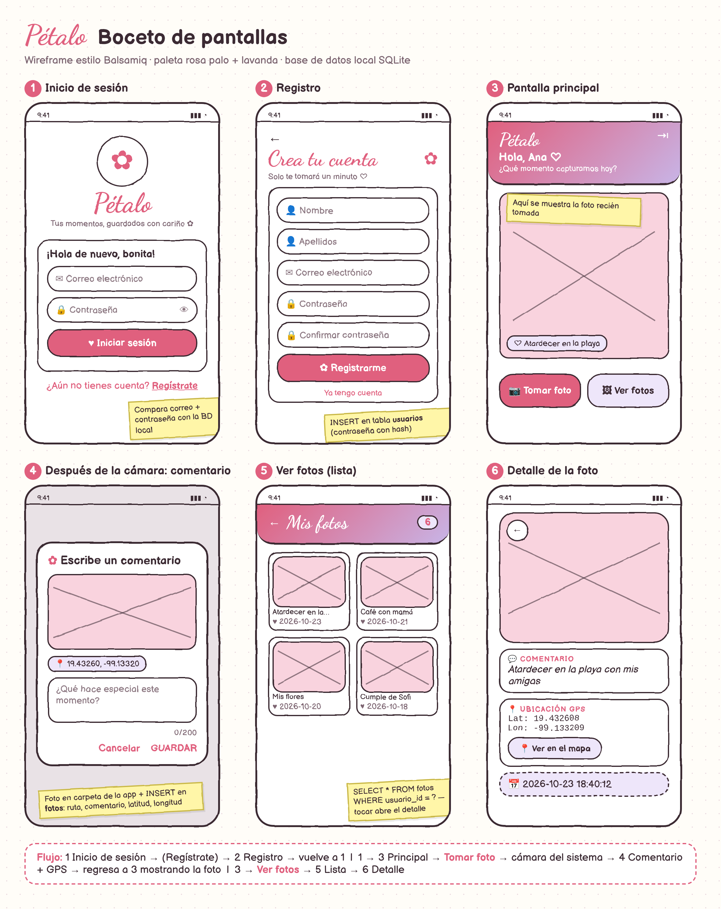

<div align="center">

# ✿ Pétalo

**Aplicación Android para capturar, guardar y revivir tus momentos, con ubicación GPS y comentarios.**


</div>

---

## 📖 Descripción

**Pétalo** es una aplicación nativa para Android, desarrollada en **Kotlin**, que permite a cada usuaria registrarse, iniciar sesión y crear su propia galería de fotografías. Cada foto se guarda junto con un **comentario personal** y la **ubicación GPS** del lugar donde se tomó. Todos los datos se guardan en el dispositivo, en una base de datos **SQLite**.

La interfaz sigue los lineamientos de **Material Design 3**, con una identidad visual femenina: paleta rosa palo y lavanda, tipografía manuscrita en los títulos y componentes de esquinas redondeadas.

---

## ✨ Funcionalidades

| Módulo | Descripción |
|---|---|
| 🔐 **Registro de usuario** | Alta con nombre, apellidos, correo electrónico y contraseña. Valida campos obligatorios, el formato del correo, correos duplicados y la confirmación de la contraseña. |
| 🔑 **Inicio de sesión** | Compara las credenciales con la base de datos local y mantiene la sesión activa entre aperturas de la app. |
| 🏠 **Pantalla principal** | Muestra un saludo personalizado, una vista previa de la última fotografía y acceso rápido a **Tomar foto** y **Ver fotos**. |
| 📷 **Captura de fotografía** | Abre la cámara del dispositivo, guarda la imagen en el directorio privado de la app y registra el comentario y las coordenadas GPS. |
| 🖼️ **Galería** | Consulta en la base de datos las fotos de la usuaria y las presenta en una cuadrícula, de la más reciente a la más antigua. |
| 📍 **Detalle de la foto** | Muestra la imagen con su comentario, latitud, longitud y fecha. Incluye un botón para abrir la ubicación en la app de mapas. |

---

## 🎨 Diseño

El boceto (wireframe) de las pantallas se hizo antes del desarrollo, con estilo Balsamiq:

<p align="center">
  
</p>

**Paleta de colores**

| Color | Hex | Uso |
|---|---|---|
| 🌸 Rosa principal | `#E0607E` | Botones primarios, íconos y acentos |
| 🍓 Rosa oscuro | `#B8405E` | Títulos y textos destacados |
| 🩰 Rosa claro | `#F9D3DE` | Contenedores y fondos de imagen |
| 💜 Lavanda | `#C8B4E6` | Color secundario y degradados |
| 🍇 Ciruela | `#5B2C4A` | Texto principal |

---

## 🛠️ Tecnologías

- **Lenguaje:** Kotlin
- **SDK mínimo / objetivo:** API 24 (Android 7.0) / API 34 (Android 14)
- **Persistencia:** SQLite mediante `SQLiteOpenHelper`
- **UI:** Material Components 3, View Binding, RecyclerView, ConstraintLayout
- **Cámara:** `ActivityResultContracts.TakePicture` + `FileProvider`
- **Ubicación:** `LocationManager` / `LocationManagerCompat` (no requiere Google Play Services)
- **Imágenes:** decodificación escalada, caché `LruCache` y corrección de orientación con `ExifInterface`
- **Build:** Gradle 8.7 · Android Gradle Plugin 8.5.2 · Kotlin DSL

---

## 🗄️ Modelo de datos

La base de datos local `petalo.db` contiene dos tablas relacionadas:

```sql
CREATE TABLE usuarios (
    id              INTEGER PRIMARY KEY AUTOINCREMENT,
    nombre          TEXT NOT NULL,
    apellidos       TEXT NOT NULL,
    correo          TEXT NOT NULL UNIQUE COLLATE NOCASE,
    contrasena_hash TEXT NOT NULL,
    sal             TEXT NOT NULL,
    fecha_registro  TEXT NOT NULL
);

CREATE TABLE fotos (
    id          INTEGER PRIMARY KEY AUTOINCREMENT,
    usuario_id  INTEGER NOT NULL,
    ruta        TEXT NOT NULL,
    comentario  TEXT NOT NULL DEFAULT '',
    latitud     REAL,
    longitud    REAL,
    fecha       TEXT NOT NULL,
    FOREIGN KEY (usuario_id) REFERENCES usuarios(id) ON DELETE CASCADE
);
```

```
usuarios 1 ──────< N fotos
```

---

## 🔒 Seguridad y privacidad

- Las contraseñas **nunca se guardan en texto plano**: se guarda un hash `SHA-256` combinado con una **sal aleatoria** distinta para cada usuaria.
- Las fotografías se guardan en el **almacenamiento privado de la aplicación** (`Android/data/com.petalo.fotos/files/Pictures/Petalo/`), al que no acceden otras apps.
- Cada usuaria solo puede consultar **sus propias fotografías**.
- Los permisos se solicitan **en tiempo de ejecución** y solo cuando se necesitan.

---

## 📱 Permisos

| Permiso | Motivo |
|---|---|
| `CAMERA` | Tomar fotografías |
| `ACCESS_FINE_LOCATION` | Obtener las coordenadas GPS precisas de cada foto |
| `ACCESS_COARSE_LOCATION` | Ubicación aproximada cuando no hay GPS disponible |

> Si la usuaria niega el permiso de ubicación, la fotografía se guarda de todas formas y en el detalle se muestra *"Sin ubicación registrada"*.

---

## 🚀 Instalación y ejecución

### Requisitos
- [Android Studio](https://developer.android.com/studio) Koala (2024.1) o superior
- JDK 17 (incluido en Android Studio)
- Android SDK Platform 34
- Dispositivo o emulador con Android 7.0 o superior y cámara

### Pasos

```bash
# 1. Clonar el repositorio
git clone https://github.com/<tu-usuario>/PetaloFotos.git

# 2. Abrir la carpeta en Android Studio
#    File › Open › PetaloFotos

# 3. Esperar la sincronización de Gradle y ejecutar ▶ Run
```

> 💡 **Para probar el GPS en el emulador:** *Extended Controls (⋯) › Location*, elige un punto en el mapa y pulsa **Set Location**.

---

## 📂 Estructura del proyecto

```
PetaloFotos/
├── app/src/main/
│   ├── java/com/petalo/fotos/
│   │   ├── data/
│   │   │   ├── BaseDatos.kt          # SQLiteOpenHelper: tablas y consultas
│   │   │   └── Modelos.kt            # Data classes Usuario y Foto
│   │   ├── ui/
│   │   │   ├── LoginActivity.kt      # Inicio de sesión
│   │   │   ├── RegistroActivity.kt   # Registro de usuarias
│   │   │   ├── MainActivity.kt       # Pantalla principal y captura
│   │   │   ├── ListaFotosActivity.kt # Galería (RecyclerView + Adapter)
│   │   │   └── DetalleFotoActivity.kt# Comentario y ubicación GPS
│   │   └── util/
│   │       ├── Seguridad.kt          # Hash SHA-256 con sal
│   │       ├── Sesion.kt             # Persistencia de la sesión
│   │       ├── Ubicacion.kt          # Obtención de coordenadas GPS
│   │       └── Imagenes.kt           # Carga eficiente y rotación EXIF
│   ├── res/                          # Layouts, estilos, colores e íconos
│   └── AndroidManifest.xml
├── boceto/                           # Wireframe de las pantallas
└── build.gradle.kts
```

---

## 🔄 Flujo de la aplicación

```
Inicio de sesión ──► Registro ──► (regresa a Inicio de sesión)
       │
       ▼
Pantalla principal ──► Tomar foto ──► Cámara ──► Comentario + GPS ──► Guardar en BD
       │
       ▼
   Ver fotos ──► Galería ──► Detalle (comentario · ubicación · fecha · mapa)
```

---

## 🌱 Mejoras futuras

- [ ] Eliminar y editar fotografías y comentarios
- [ ] Mapa con todas las fotos geolocalizadas
- [ ] Compartir fotos en redes sociales
- [ ] Modo oscuro
- [ ] Migración a Room y arquitectura MVVM

---

## 👩‍💻 Autora

**AURA NICTE-HA PECH REYES**
📧 [aura.nicte9510@gmail.com] 

---

<div align="center">

Hecho en Kotlin

</div>
